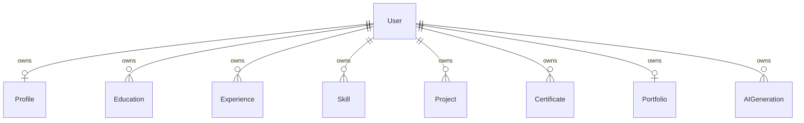

# Database Documentation

## Overview

The project uses PostgreSQL and Prisma ORM. The authoritative model definitions are in `backend/prisma/schema.prisma`; physical table and constraint creation is represented by the checked-in migrations listed below. The Prisma Client is generated by the configured `prisma-client-js` generator.

Notation in the model tables: `?` means nullable/optional; `[]` means a collection; `@default` values are Prisma/database defaults as shown in the schema. `DateTime @db.Date` represents a date-only PostgreSQL `DATE`, not a timestamp.

## Models and fields

### `User` → `users`

| Field | Prisma type | Null/default/constraints |
|---|---|---|
| `id` | `String` (`Uuid`) | Required primary key; `uuid()` |
| `name` | `String` (`VarChar(120)`) | Required |
| `email` | `String` (`VarChar(320)`) | Required, unique |
| `passwordHash` (`password_hash`) | `String` (`VarChar(255)`) | Required |
| `createdAt` (`created_at`) | `DateTime` | Required; `now()` |
| `updatedAt` (`updated_at`) | `DateTime` | Required; Prisma `@updatedAt` |
| `profile` | `Profile?` | Optional one-to-one inverse relation |
| `education`, `experience`, `skills`, `projects`, `certificates` | Model arrays | One-to-many inverse relations |
| `portfolio` | `Portfolio?` | Optional one-to-one inverse relation |
| `aiGenerations` | `AIGeneration[]` | One-to-many inverse relation |

### `Profile` → `profiles`

| Field | Prisma type | Null/default/constraints |
|---|---|---|
| `id` | `String` (`Uuid`) | Required primary key; `uuid()` |
| `userId` (`user_id`) | `String` (`Uuid`) | Required, unique; foreign key to `User.id` |
| `phone` | `String` (`VarChar(40)`) | Optional |
| `location` | `String` (`VarChar(160)`) | Optional |
| `headline` | `String` (`VarChar(200)`) | Optional |
| `bio` | `String` / PostgreSQL `TEXT` | Optional |
| `profileImage` (`profile_image`) | `String` (`VarChar(2048)`) | Optional path or URL |
| `linkedinUrl` (`linkedin_url`) | `String` (`VarChar(2048)`) | Optional |
| `githubUrl` (`github_url`) | `String` (`VarChar(2048)`) | Optional |
| `websiteUrl` (`website_url`) | `String` (`VarChar(2048)`) | Optional |
| `createdAt` (`created_at`) | `DateTime` | Required; `now()` |
| `updatedAt` (`updated_at`) | `DateTime` | Required; Prisma `@updatedAt` |

### `Education` → `education`

| Field | Prisma type | Null/default/constraints |
|---|---|---|
| `id` | `String` (`Uuid`) | Required primary key; `uuid()` |
| `userId` (`user_id`) | `String` (`Uuid`) | Required; foreign key to `User.id` |
| `institution` | `String` (`VarChar(200)`) | Required |
| `degree`, `field` | `String` (`VarChar(160)`) | Optional |
| `startDate`, `endDate` (`*_date`) | `DateTime` (`Date`) | Optional |
| `description` | `String` / `TEXT` | Optional |
| `createdAt` (`created_at`) | `DateTime` | Required; `now()` |
| `updatedAt` (`updated_at`) | `DateTime` | Required; Prisma `@updatedAt` |

Indexes: `(userId)`, `(userId, startDate)`.

### `Experience` → `experience`

| Field | Prisma type | Null/default/constraints |
|---|---|---|
| `id` | `String` (`Uuid`) | Required primary key; `uuid()` |
| `userId` (`user_id`) | `String` (`Uuid`) | Required; foreign key to `User.id` |
| `company`, `position` | `String` (`VarChar(200)`) | Required |
| `startDate`, `endDate` (`*_date`) | `DateTime` (`Date`) | Optional |
| `description` | `String` / `TEXT` | Optional |
| `createdAt` (`created_at`) | `DateTime` | Required; `now()` |
| `updatedAt` (`updated_at`) | `DateTime` | Required; Prisma `@updatedAt` |

Indexes: `(userId)`, `(userId, startDate)`.

### `Skill` → `skills`

| Field | Prisma type | Null/default/constraints |
|---|---|---|
| `id` | `String` (`Uuid`) | Required primary key; `uuid()` |
| `userId` (`user_id`) | `String` (`Uuid`) | Required; foreign key to `User.id` |
| `name` | `String` (`VarChar(120)`) | Required |
| `category` | `String` (`VarChar(120)`) | Optional |
| `proficiency` | `Int` | Optional |
| `createdAt` (`created_at`) | `DateTime` | Required; `now()` |
| `updatedAt` (`updated_at`) | `DateTime` | Required; Prisma `@updatedAt` |

Indexes: `(userId)`, `(userId, category)`. API validation, unlike the database column, restricts proficiency to integer 0–100.

### `Project` → `projects`

| Field | Prisma type | Null/default/constraints |
|---|---|---|
| `id` | `String` (`Uuid`) | Required primary key; `uuid()` |
| `userId` (`user_id`) | `String` (`Uuid`) | Required; foreign key to `User.id` |
| `title` | `String` (`VarChar(200)`) | Required |
| `description` | `String` / `TEXT` | Optional |
| `technologies` | `String[]` / PostgreSQL `TEXT[]` | Required; default `[]` |
| `githubUrl` (`github_url`), `liveUrl` (`live_url`), `imageUrl` (`image_url`) | `String` (`VarChar(2048)`) | Optional |
| `createdAt` (`created_at`) | `DateTime` | Required; `now()` |
| `updatedAt` (`updated_at`) | `DateTime` | Required; Prisma `@updatedAt` |

Index: `(userId)`.

### `Certificate` → `certificates`

| Field | Prisma type | Null/default/constraints |
|---|---|---|
| `id` | `String` (`Uuid`) | Required primary key; `uuid()` |
| `userId` (`user_id`) | `String` (`Uuid`) | Required; foreign key to `User.id` |
| `name` | `String` (`VarChar(200)`) | Required |
| `issuer` | `String` (`VarChar(200)`) | Optional |
| `issueDate` (`issue_date`) | `DateTime` (`Date`) | Optional |
| `credentialUrl` (`credential_url`) | `String` (`VarChar(2048)`) | Optional |
| `createdAt` (`created_at`) | `DateTime` | Required; `now()` |
| `updatedAt` (`updated_at`) | `DateTime` | Required; Prisma `@updatedAt` |

Indexes: `(userId)`, `(userId, issueDate)`.

### `Portfolio` → `portfolios`

| Field | Prisma type | Null/default/constraints |
|---|---|---|
| `id` | `String` (`Uuid`) | Required primary key; `uuid()` |
| `userId` (`user_id`) | `String` (`Uuid`) | Required, unique; foreign key to `User.id` |
| `title` | `String` (`VarChar(200)`) | Required |
| `slug` | `String` (`VarChar(160)`) | Required, unique |
| `template` | `String` (`VarChar(80)`) | Required; default `professional` |
| `isPublished` (`is_published`) | `Boolean` | Required; default `false` |
| `createdAt` (`created_at`) | `DateTime` | Required; `now()` |
| `updatedAt` (`updated_at`) | `DateTime` | Required; Prisma `@updatedAt` |

Index: `(isPublished)`.

### `AIGeneration` → `ai_generations`

| Field | Prisma type | Null/default/constraints |
|---|---|---|
| `id` | `String` (`Uuid`) | Required primary key; `uuid()` |
| `userId` (`user_id`) | `String` (`Uuid`) | Required; foreign key to `User.id` |
| `type` | `String` (`VarChar(80)`) | Required |
| `inputText` (`input_text`), `outputText` (`output_text`) | `String` / PostgreSQL `TEXT` | Required |
| `status` | `String` (`VarChar(40)`) | Required; default `PENDING` |
| `targetType` (`target_type`) | `String` (`VarChar(80)`) | Optional |
| `targetId` (`target_id`) | `String` (`VarChar(80)`) | Optional |
| `editedText` (`edited_text`) | `String` / `TEXT` | Optional |
| `createdAt` (`created_at`) | `DateTime` | Required; `now()` |
| `updatedAt` (`updated_at`) | `DateTime` | Required; Prisma `@updatedAt` |

Indexes: `(userId)`, `(userId, createdAt)`, `(userId, status)`. The schema stores type/status/target identifiers as strings, not database enums or foreign keys to target records.

## Keys, relationships, and deletion

Every model has a UUID primary key. Foreign keys from `Profile`, `Education`, `Experience`, `Skill`, `Project`, `Certificate`, `Portfolio`, and `AIGeneration` point to `User.id`. All eight relations specify `onDelete: Cascade` and `onUpdate: Cascade`: deleting a user cascades to those related rows. There are no foreign keys between career records or from AI targets to specific career models.

`Profile.userId` and `Portfolio.userId` are unique, making each an optional one-to-one relation from `User`; all other user relations are one-to-many. `User.email` and `Portfolio.slug` are unique. There are no other declared unique constraints or explicit standalone indexes beyond those noted per model.



The diagram omits fields for readability. AI `targetType`/`targetId` are not relational foreign keys.

## Migration history

1. `20260919133202_init`: creates the nine tables, initial unique/index constraints, and cascading user foreign keys. In this migration, `ai_generations` has `id`, `user_id`, `type`, `input_text`, `output_text`, and `created_at`.
2. `20260919165434_add_ai_recommendation_status`: adds `edited_text`, `status` (default `PENDING`), `target_id`, `target_type`, and required `updated_at`; adds `(user_id, status)` index.

The second migration SQL includes a warning that adding required `updated_at` without a default is not possible when `ai_generations` already contains rows. Check the actual target database and migration state before applying it to populated data. Do not erase data or use a reset as a workaround.

## Validation, generation, and safe application

From the repository root, set `DATABASE_URL` securely in the environment (or a local ignored `.env`) and run:

```bash
npm run prisma:validate
npm run prisma:generate
```

Development migration command:

```bash
npm run prisma:migrate -- --name descriptive_change
```

This invokes `prisma migrate dev`; use it only in development. Before applying changes to a shared/production database, review the SQL, make and verify a restorable backup, and use Prisma's deploy workflow:

```bash
npx prisma migrate deploy --schema backend/prisma/schema.prisma
```

The deploy command is not a project package script, but uses the installed Prisma CLI. Confirm migration status and database target before running. Never run reset commands against a database containing data.

## Privacy and ownership

The schema associates every profile, career record, portfolio, and AI generation with `userId`. The API derives ownership from authenticated JWT claims; it does not rely on a caller-supplied owner ID. A public published portfolio returns selected user identity plus profile and career relations; public content is therefore not private while published. Profile phone, location, bio, social URLs, and career details may be exposed by those included records. The public response does not include the account email through its safe-user selection. AI prompt inputs/outputs are persisted in `ai_generations`; treat this as user data and apply appropriate database access, retention, and backup controls.

For endpoint-level ownership and publication rules, see [API Documentation](./API_DOCUMENTATION.md).
