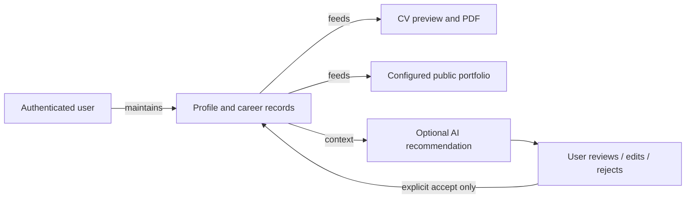
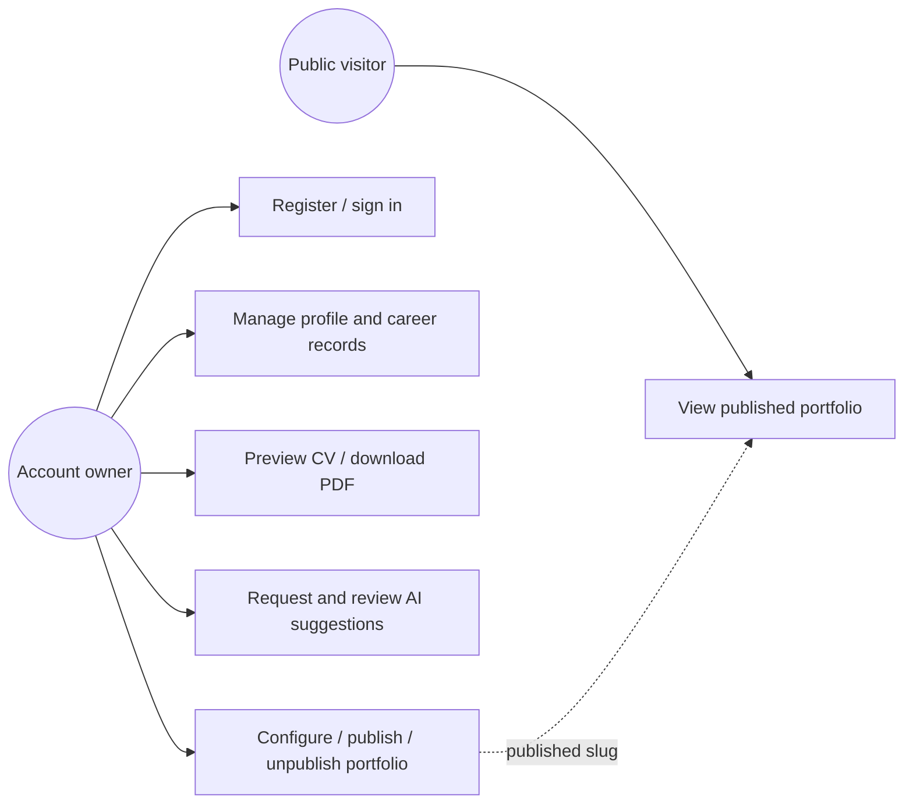

# Final Project Report

## Title page details

**Project title:** AI-Powered Dynamic Web CV and Portfolio Management System  
**Student name:** [TO BE PROVIDED BY STUDENT]  
**Registration number:** [TO BE PROVIDED BY STUDENT]  
**Institution / department:** [TO BE PROVIDED BY STUDENT]  
**Supervisor:** [TO BE PROVIDED BY STUDENT]  
**Submission date:** [TO BE PROVIDED BY STUDENT]

## Abstract

This project implements a web application for managing professional profile information and career records, composing a CV preview, downloading a PDF, and publishing a public portfolio. The system is structured as a React/Vite client, an Express API, and a PostgreSQL database accessed through Prisma. Account authentication and owner-scoped operations protect private profile and career data. Optional Groq-based AI endpoints generate writing and job-description recommendations that are persisted and require user review before application. The repository includes backend automated tests and frontend build/lint checks. In the documented validation run, 304 backend tests passed, the frontend build and lint completed successfully, and Prisma schema validation passed with a placeholder connection URL. No live database migration, live AI provider, authenticated browser test, or deployment was verified. The work therefore demonstrates an implemented local application and selected automated behaviors, not a deployed or fully production-validated service.

## Front matter

### Acknowledgements

[TO BE PROVIDED BY STUDENT. Add only genuine acknowledgements.]

### Table of contents

Generate the table of contents using the word processor or Markdown renderer selected for submission. Update page numbers after final formatting.

### List of figures

1. Figure 1. High-level system architecture.
2. Figure 2. Account and content use-case flow.
3. Figure 3. Database relationship diagram.

### List of tables

1. Table 1. Functional requirements.
2. Table 2. System modules.
3. Table 3. Automated test summary.

## CHAPTER ONE: INTRODUCTION

### 1.1 Background

Job seekers and professionals need to present consistent information about education, work experience, skills, projects, and credentials. Maintaining this information in separate files can make updates and reuse difficult. This project addresses the practical need for one web workspace from which a user can maintain career data and prepare a CV and public portfolio.

The term “AI-powered” refers to implemented, optional Groq-backed writing and job-description recommendation endpoints. It does not imply autonomous CV generation, factual verification, or a verified live AI service.

### 1.2 Problem statement

When professional details are stored in disconnected documents, users must repeatedly revise the same information for different presentations. The project implements a centralized data workflow but does not claim that all existing alternatives fail or that the system has measured improvements.

### 1.3 Objectives

**Main objective:** implement a web-based system for managing professional CV data and presenting it through a CV and portfolio workflow.

**Specific objectives:**

1. Implement account registration, login, token verification, and owner-scoped data access.
2. Implement profile and career record management.
3. Implement browser CV preview layouts, section controls, and PDF generation.
4. Implement portfolio configuration, preview, publication, and public retrieval.
5. Implement optional review-first AI recommendations for professional writing and job analysis.
6. Validate selected backend behaviors through automated tests and run frontend/schema checks.

### 1.4 Research questions

These are project framing questions, not claims of a formal study:

1. How can profile and career records be managed in a single owner-scoped application?
2. How can those records be reused to produce a CV preview, PDF, and public portfolio?
3. How can optional AI suggestions be introduced without automatically changing user-authored data?

### 1.5 Significance

The application provides a single interface for managing career information and reusing it for professional documents. The explicit recommendation review step gives the user control over AI-generated text. Its value has not been evaluated through user research or a controlled study.

### 1.6 Scope

The implemented scope includes account authentication, profile and career-data CRUD, CV preview and PDF, portfolio settings/public access, and optional AI assistance. It does not include an evidenced administrative role system, hosted deployment configuration, external job-application workflow, or formal user-study results.

### 1.7 Limitations

The repository does not establish a deployed environment, live provider operation, authenticated browser acceptance, user research, performance measurements, operational monitoring, backup automation, formal accessibility compliance, or production security certification. Student and institutional metadata remain to be supplied.

## CHAPTER TWO: LITERATURE REVIEW

### 2.1 Relevant concepts

- **Web application architecture:** the client communicates with an API that applies application rules and persists data in a relational database.
- **Relational data management:** profiles and career records are linked to an account through foreign keys.
- **Authentication and authorization:** authentication establishes the account represented by a request; authorization scopes private records to that account.
- **AI-assisted writing:** generated text is a suggestion, not a verified fact. User review and explicit acceptance are implemented for saved recommendations.
- **Digital portfolios and CVs:** the system reuses managed records to create a browser preview, PDF, and public page.

### 2.2 Existing approaches and practical gap

The repository contains no documented market study, literature search, participant interviews, questionnaire results, or comparative evaluation of existing products. Therefore no empirical ranking or claim of superiority is made here. As a practical design comparison:

| Approach | General characteristic | Limitation addressed by this project |
|---|---|---|
| Separate word-processing files | Flexible, user-controlled documents | Information may need to be copied and updated repeatedly |
| Static portfolio pages | Public presentation of selected content | Content may require manual code or page updates |
| Centralized CV data with generated outputs | Reuses saved career records | Requires account protection and careful publication controls |

This is a conceptual comparison, not a measured evaluation of named commercial systems. A student literature review should add verifiable academic or industry references required by the institution.

### 2.3 References for technical concepts

The following primary technical references describe technologies used; they are not substitutes for domain literature:

1. PostgreSQL Global Development Group, *PostgreSQL Documentation*. https://www.postgresql.org/docs/
2. Prisma, *Prisma ORM Documentation*. https://www.prisma.io/docs
3. OpenJS Foundation, *Node.js Documentation*. https://nodejs.org/docs/
4. Express, *Express Documentation*. https://expressjs.com/
5. React, *React Documentation*. https://react.dev/learn
6. Groq, *Groq API Documentation*. https://console.groq.com/docs/overview
7. IETF, *RFC 7519: JSON Web Token (JWT)*. https://www.rfc-editor.org/rfc/rfc7519

Confirm citation style and access-date requirements with the institution before submission.

### 2.4 Conceptual framework

The framework distinguishes stored source data, generated presentation, public publication, and AI suggestion review.

## CHAPTER THREE: SYSTEM ANALYSIS AND DESIGN

### 3.1 Requirements gathering approach

No interview, questionnaire, or formal requirements-gathering artifact is evidenced in this repository. This report derives system requirements from the implemented source files and existing planning documents. The student should add the actual requirements process used, if any: **[TO BE PROVIDED BY STUDENT]**.

### 3.2 Requirements

| ID | Functional requirement |
|---|---|
| FR-01 | Register, log in, and retrieve the current authenticated user |
| FR-02 | Read/update profile fields and upload/remove a profile image |
| FR-03 | Manage education, experience, skills, projects, and certificates |
| FR-04 | Compose a browser CV preview and download a server-generated PDF |
| FR-05 | Configure one portfolio per user and publish/unpublish it |
| FR-06 | Retrieve published portfolios publicly by slug |
| FR-07 | Generate optional AI recommendations and review/edit/accept/reject saved results |

Security and operational requirements evidenced by code include bearer-token authentication, password hashing, owner-scoped operations, input validation, CORS configuration, bounded JSON/upload input, and no client-controlled ownership assignment. Performance, availability, accessibility, retention, and deployment requirements remain unspecified.

### 3.3 Methodology

The source tree demonstrates incremental implementation across database, authentication, content management, CV, portfolio, AI, and testing modules. No formal named software-development methodology or dated iteration record is evidenced. The student should describe the actual development process: **[TO BE PROVIDED BY STUDENT]**.

### 3.4 Architecture

The browser uses React and Vite. Its API client communicates with Express over HTTP using JSON or multipart image data and bearer tokens. Express validates and authorizes requests, services use Prisma Client to access PostgreSQL, and optional AI actions call Groq. PDFKit creates PDF output. Profile images are stored as files and referenced by path.

### 3.5 Use cases

### 3.6 Database design

`User` has optional one-to-one relations to `Profile` and `Portfolio`, and one-to-many relations to `Education`, `Experience`, `Skill`, `Project`, `Certificate`, and `AIGeneration`. User deletion cascades to related records. See the field-level inventory and ER diagram in [Database Documentation](./DATABASE_DOCUMENTATION.md).

### 3.7 UI and workflow design

The app has login/registration pages, an authenticated workspace with profile and career-data pages, CV Builder controls/preview, AI Assistant, and portfolio settings/preview. Public portfolios are routed separately by slug. Exact design rationale or user usability evidence is not present; screenshots should be captured from synthetic data for the final academic submission.

### 3.8 Security considerations

Passwords are hashed using bcrypt; JWTs are verified by middleware; data ownership is determined from the token; validation rejects unsupported fields; image size and file signatures are checked; CORS is origin-allow-listed. The public endpoint returns portfolio-associated profile and career data when published. Deployment TLS, security monitoring, formal penetration testing, key management procedures, and privacy-policy compliance are not evidenced and require separate review.

## CHAPTER FOUR: IMPLEMENTATION AND TESTING

### 4.1 Technologies

React/Vite, Node.js/Express, PostgreSQL/Prisma, bcryptjs, jsonwebtoken, Groq SDK, PDFKit, Multer, Node test runner, and ESLint are present in package manifests or implementation.

### 4.2 Implemented modules

1. Authentication and token middleware.
2. Profile and image management.
3. Owner-scoped CRUD for five career data categories.
4. CV browser templates, section toggles, and PDF endpoint.
5. Portfolio settings, preview, publish/unpublish, and public slug route.
6. Review-first AI generation and recommendation management.

### 4.3 API and database implementation

The Express app mounts route modules at `/api/auth`, `/api/profile`, `/api/education`, `/api/experience`, `/api/skills`, `/api/projects`, `/api/certificates`, `/api/portfolio`, `/api/ai`, `/api/cv`, and `/api/public`. PostgreSQL models and two checked-in migrations are documented in the database report. Full endpoint inventory is in [API Documentation](./API_DOCUMENTATION.md).

### 4.4 CV and portfolio workflows

The CV Builder reads user data for preview and stores local presentation settings in the browser. The PDF endpoint separately derives its output from persisted account data. Portfolio settings persist a title, slug, template, and publication flag; the public route returns content only while published. AI generation persists recommendations and includes explicit review operations.

### 4.5 Testing methodology and results

Backend tests use Node's test runner, an ephemeral local HTTP server, Prisma method stubs/in-memory fixtures, and mocked AI behavior. Current run results:

| Check | Result |
|---|---|
| Backend suite | 304 passed, 0 failed, 32 suites |
| Frontend build | Passed; 37 modules transformed |
| Frontend lint | Passed; no diagnostics printed |
| Prisma schema validation | Passed with a placeholder `DATABASE_URL` |
| Live database/migrations | Not executed |
| Live Groq service | Not executed |
| Authenticated browser/manual test | Not executed |

Detailed evidence and gaps are in [Testing Report](./TESTING_REPORT.md). Passing tests do not demonstrate complete coverage.

### 4.6 Implementation limitations

The checked-in AI integration's live provider operation is unverified. No hosted deployment is evidenced. CV browser settings are not applied by the PDF API. Published portfolio content exposes the API's included relations. The second migration may fail against existing AI-generation rows because it adds a required timestamp without a default.

## CHAPTER FIVE: CONCLUSION AND RECOMMENDATIONS

### 5.1 Conclusion

The source code implements a local web application that centralizes account-owned profile and career records and provides CV, portfolio, and optional AI-assisted workflows. Automated backend tests and frontend/schema checks passed in the documented run. This supports the conclusion that selected implemented behaviors work under test conditions; it does not establish production readiness, deployed operation, live AI integration, or browser usability.

### 5.2 Objectives achieved

The source implements each of the six specific objectives in Section 1.3. Backend tests exercise many corresponding API behaviors. The student should verify the intended academic acceptance criteria and add any required empirical evidence before submission.

### 5.3 Limitations and future work

Future work includes safe production migration planning, live-database integration tests, authenticated browser and accessibility testing, live AI-provider validation, privacy/retention documentation, deployment and operational monitoring, backup/restore procedures, and evaluation with intended users. These are recommendations, not completed features.

### 5.4 Recommendations

1. Validate all database migrations on disposable, representative test databases before shared deployment.
2. Add browser end-to-end coverage using synthetic accounts and content.
3. Conduct privacy/security review of public fields, local storage, uploads, AI data processing, and deployment controls.
4. Align CV PDF options with user-visible template/section settings if that behavior is required.
5. Record a verifiable deployment and live provider test only after they have been performed.

## References

See the verifiable official technical references in Chapter Two. Add institution-required academic literature after a genuine literature search; do not cite sources that were not consulted.

## Appendices

### Appendix A: API endpoint inventory

Use the protected/public route inventory in [API Documentation](./API_DOCUMENTATION.md).

### Appendix B: Selected test cases

Use the automated test inventory in [Testing Report](./TESTING_REPORT.md). Add institution-specific evidence captures only after conducting the corresponding tests.

### Appendix C: Student-specific project facts

- Student/institution/supervisor details: [TO BE PROVIDED BY STUDENT]
- Actual requirements-gathering process: [TO BE PROVIDED BY STUDENT]
- Actual development methodology and dates: [TO BE PROVIDED BY STUDENT]
- Deployment URL/environment, if later deployed: [TO BE PROVIDED BY STUDENT]
- Any required participant or approval information, only if genuine: [TO BE PROVIDED BY STUDENT]
